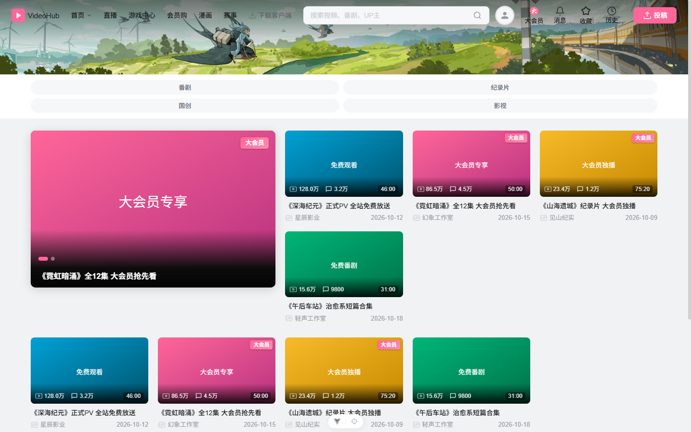
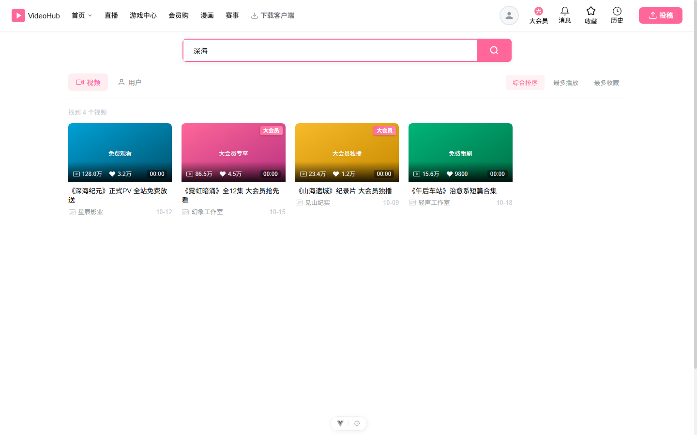
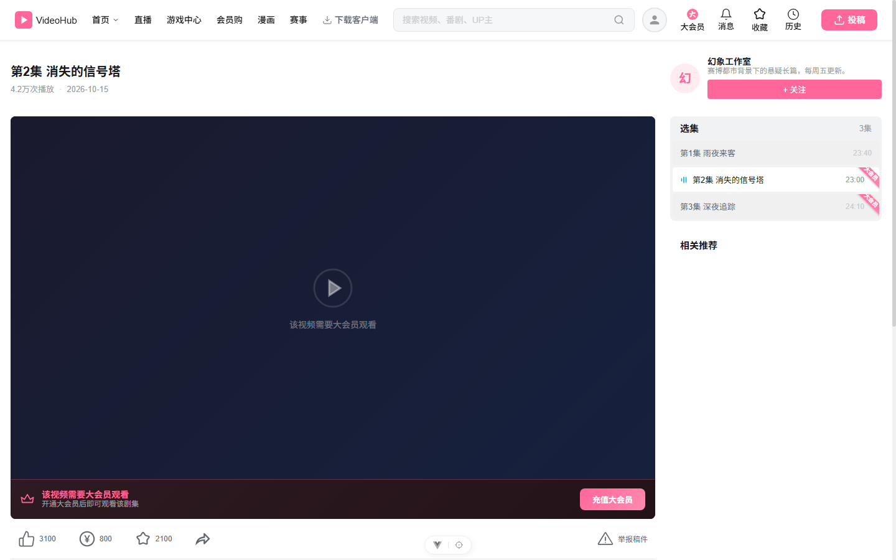
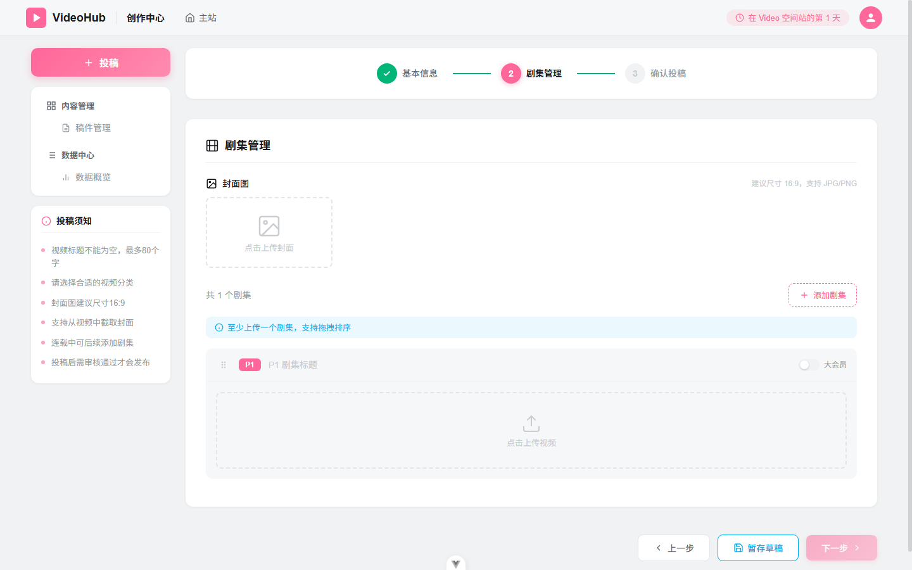

# VideoHub 前端（vue-front）

VideoHub 视频站的 **客户端 + 创作中心** 前端，包含首页推荐、分类、搜索、播放页、投稿/稿件管理、用户中心等页面，并支持 **大会员（needVip）** 内容标识与播放限制。



## 技术栈

| 类别 | 选型 |
| --- | --- |
| 框架 | Vue 3（`<script setup>` SFC） |
| 构建 | Vite 8 |
| 路由 | Vue Router 4（Hash 模式） |
| 状态 | Pinia |
| 请求 | Axios（统一响应信封 `{ code, data }`） |
| UI | Element Plus + 自定义样式 |
| 国际化 | Vue I18n |
| 播放器 | vue3-video-play |

## 快速开始

```bash
npm install
npm run dev      # 开发：http://localhost:5173
npm run build    # 生产构建
npm run preview  # 预览构建产物
```

API 基址默认为 `/api`，可通过 `VITE_API_BASE_URL` 环境变量或运行时 `window.__APP_CONFIG__.API_BASE_URL` 覆盖（见 `src/config.js`）。

## 目录结构

```
vue-front/
├── docs/screenshots/     # README 截图
├── public/
└── src/
    ├── api/              # 接口封装（axios 实例 + 各业务模块）
    ├── components/       # 通用组件（含 contribution/ 投稿表单）
    ├── composables/      # 组合式函数
    ├── i18n/             # 多语言文案
    ├── router/           # 路由与登录守卫
    ├── stores/           # Pinia（auth 等）
    ├── views/            # 页面（Home / Category / Search / VideoPlay / Contribution ...）
    ├── config.js         # API / 文件基址、fileUrl() 工具
    └── main.js
```

## 大会员（needVip）功能

后端在视频、剧集上返回 `needVip: boolean`，前端按以下方式展示。所有展示均为 **条件渲染**：接口未返回该字段时不显示任何标识，完全向后兼容。

### 1. 列表角标（封面右上角）

`/client/video/list`、`/client/video/recommend`（轮播 banner + 推荐卡片）、搜索页视频 tab 中，`needVip === true` 的视频在封面右上角显示粉色渐变角标 **「大会员」**：

- 首页最新视频 / 推荐卡片 / 轮播 → `HomeView.vue`
- 分类页视频卡片 → `CategoryView.vue`
- 搜索页视频 tab → `SearchView.vue`

```html
<span v-if="video.needVip" class="vip-corner-badge">大会员</span>
```



### 2. 播放页 VIP 锁定

`/client/video/{videoUid}/episode/{episodeUid}` 返回的当前剧集 `needVip === true`，且 `playUrl`、`playLink` 均为空时，播放器区域显示锁定提示 + **「充值大会员」** 按钮（点击通过全局事件 `open-vip-dialog` 打开大会员购买弹窗）。

该接口加载失败时页面进入错误态而非整页空白；评论、相关推荐、选集列表均独立并行加载，不受该接口影响。



### 3. 选集列表丝带标签

播放页选集（列表 / 宫格）中 `needVip === true` 的剧集，右上角显示 **rotate(45deg) 斜向丝带**「大会员」（`.episode-ribbon`），粉色渐变底白字；当前激活集反转为白底粉字保证对比度。

### 4. 投稿：剧集大会员开关

投稿新增/编辑的 **剧集管理** 步骤中，每个剧集卡片带「大会员」开关（`.vip-switch`，粉色），提交、草稿保存、编辑回显均透传 `needVip` 字段：

- `components/contribution/SubmitForm.vue` — 投稿表单
- `views/EpisodeManagementView.vue` — 稿件管理中的剧集编辑弹窗



### 样式约定

大会员主题色统一使用 CSS 变量 `var(--brand_pink)`（粉色系），角标、丝带、开关、锁定提示条均为该色系。

## 截图

| 页面 | 文件 |
| --- | --- |
| 首页（角标 + 轮播） | `docs/screenshots/home-vip-badge.png` |
| 播放页（VIP 锁定 + 选集丝带） | `docs/screenshots/play-vip-lock.png` |
| 搜索页（视频 tab 角标） | `docs/screenshots/search-vip-badge.png` |
| 投稿（剧集大会员开关） | `docs/screenshots/submit-episode-vip-switch.png` |
