# Video Admin · 视频内容管理后台

一个基于 **Vue 3 + Vite + Element Plus** 构建的现代化视频平台后台管理系统。覆盖视频内容、剧集、用户、评论、审核、分类、权限、日志与系统设置等完整运营场景，内置深浅色主题、中英文国际化、全局搜索与大数据量文件上传能力。


---

## 其他代码说明
前台代码： front分支
后台代码： admin分支
后端代码： https://github.com/clannad181/video-web

## 目录

- [界面预览](#界面预览)
- [功能特性](#功能特性)
- [技术栈](#技术栈)
- [快速开始](#快速开始)
- [环境变量](#环境变量)
- [可用脚本](#可用脚本)
- [项目结构](#项目结构)
- [模块说明](#模块说明)
- [国际化与主题](#国际化与主题)
- [重新生成截图](#重新生成截图)

---

## 界面预览

### 登录页

账号 / 邮箱双模式登录，支持图形验证码与邮箱验证码。

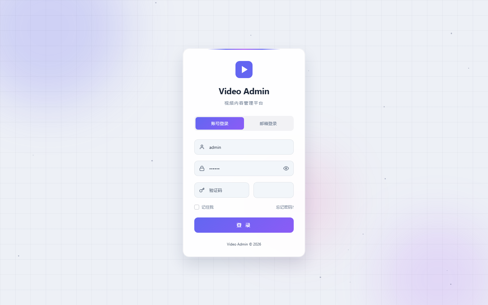

### 工作台

今日新增、待审核概览、视频增量趋势与最近动态一屏掌握。

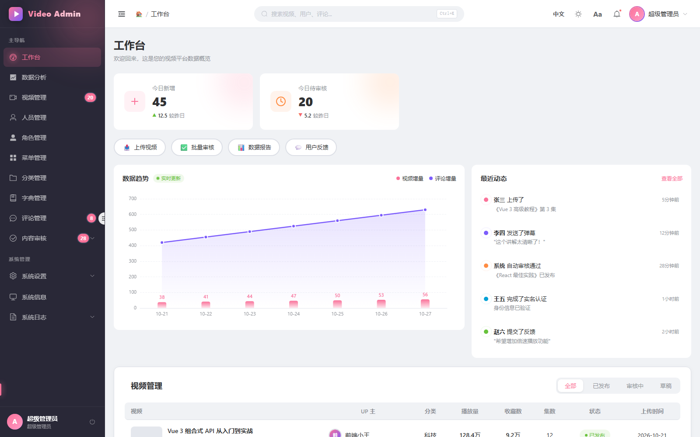

<details>
<summary>🌙 深色模式效果</summary>

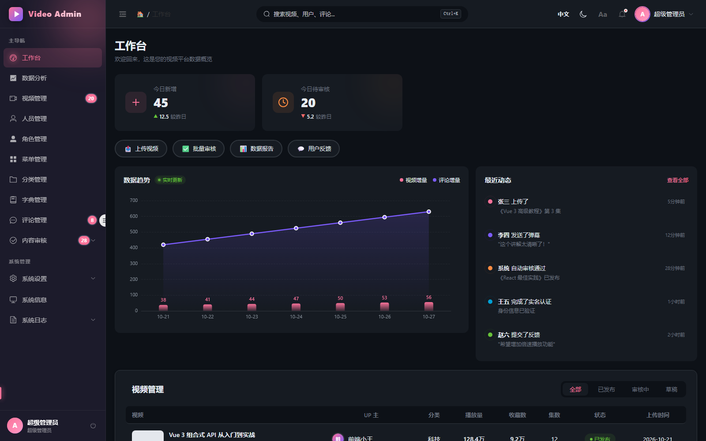

</details>

### 数据分析

播放量、活跃用户、内容分布、实时访客与分类增量多维可视化。

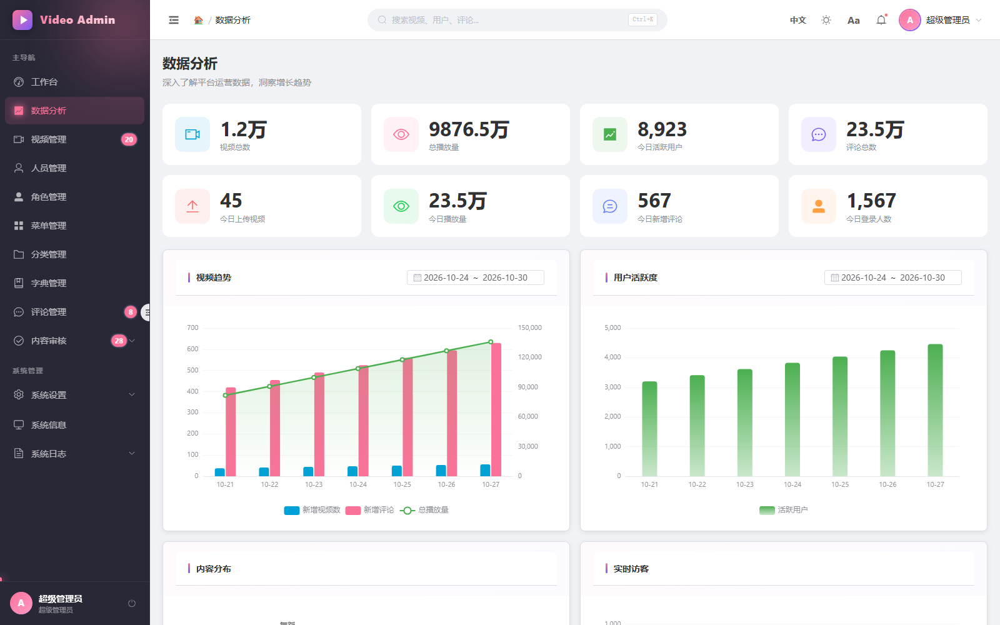

### 视频管理

视频检索、排序、详情预览、新增 / 编辑、封面上传与截帧、剧集管理、大文件分片上传。

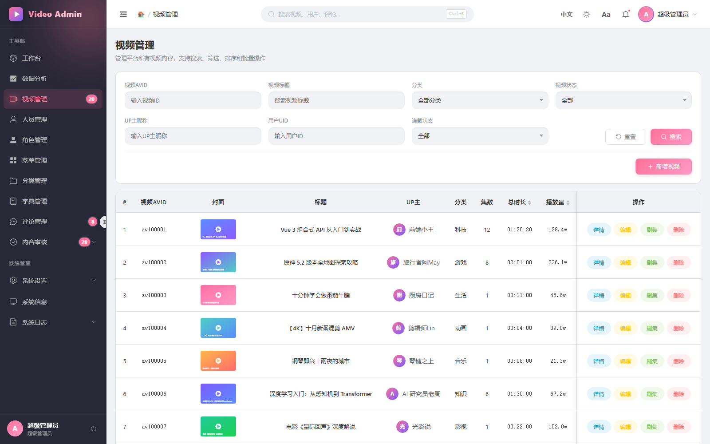

### 人员管理

「管理人员 / 用户」双 Tab 切换，支持用户名、昵称、邮箱、状态、角色筛选与账号操作。

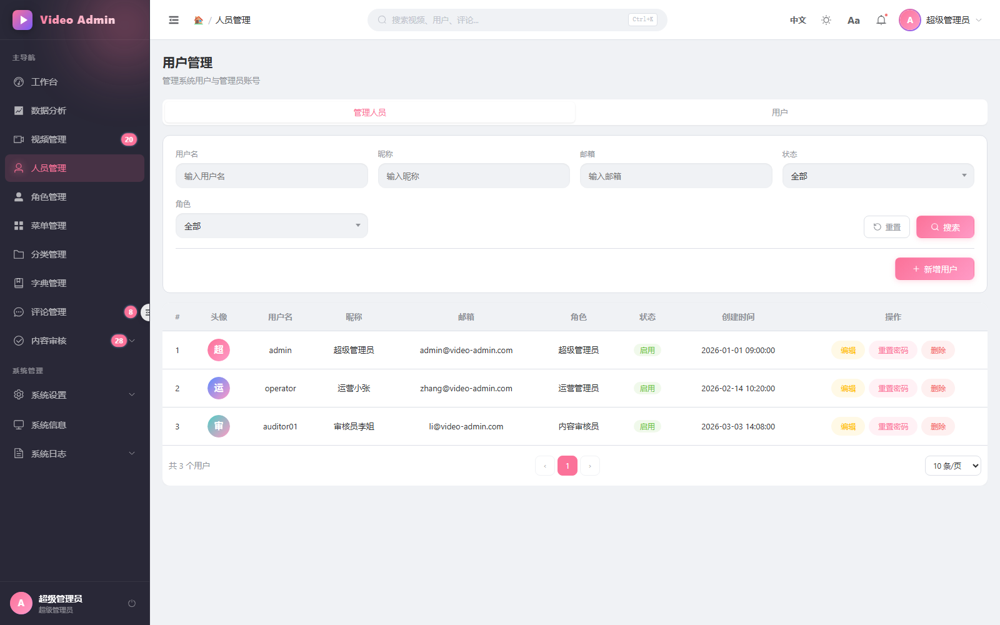

### 评论管理

评论检索、视频关联、点赞 / 回复统计、批量删除与屏蔽操作。

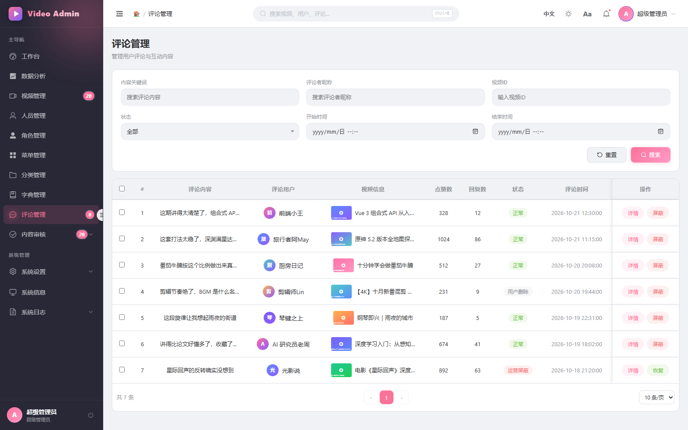

### 内容审核

稿件审核与评论审核双面板，支持通过 / 驳回与详情查看。

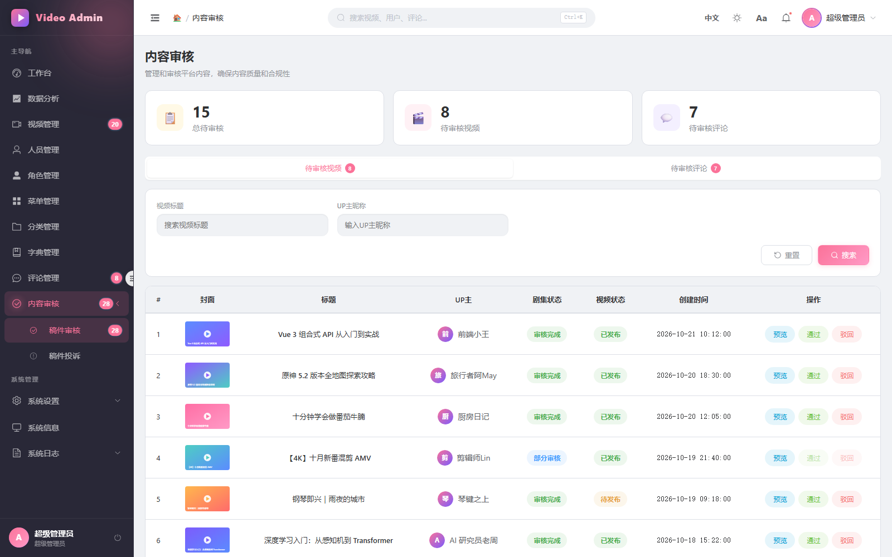

### 分类管理

分类排序、展示状态、系统内置标识与启用状态管理。

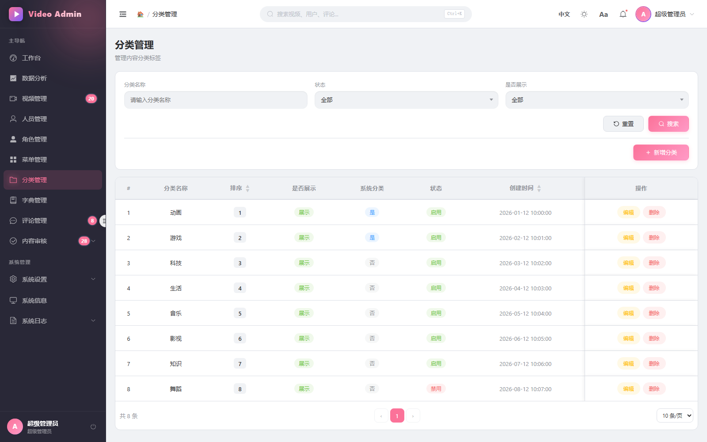

### 角色管理

角色权限配置、菜单绑定、层级与状态管理。

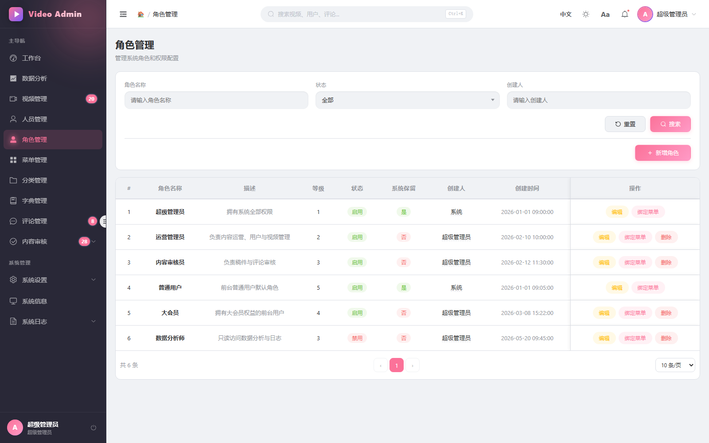

### 菜单管理

树形菜单维护，支持图标、标识符、排序与显隐控制。

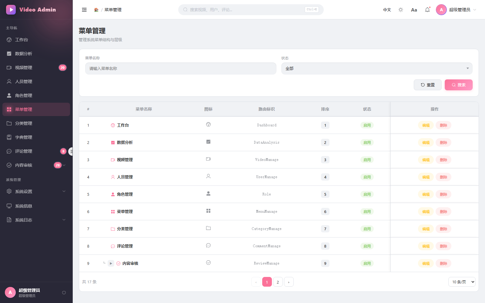

### 系统信息

JVM、CPU、内存、线程与磁盘运行状态实时监控。

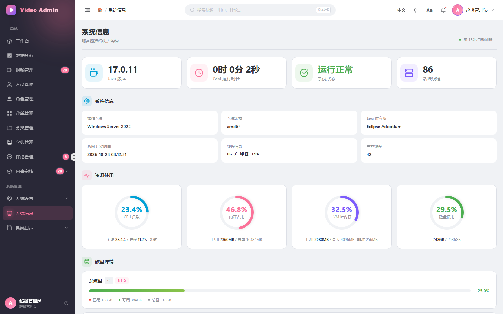

### 系统日志

登录日志、运行日志与日志统计，便于安全审计与问题排查。

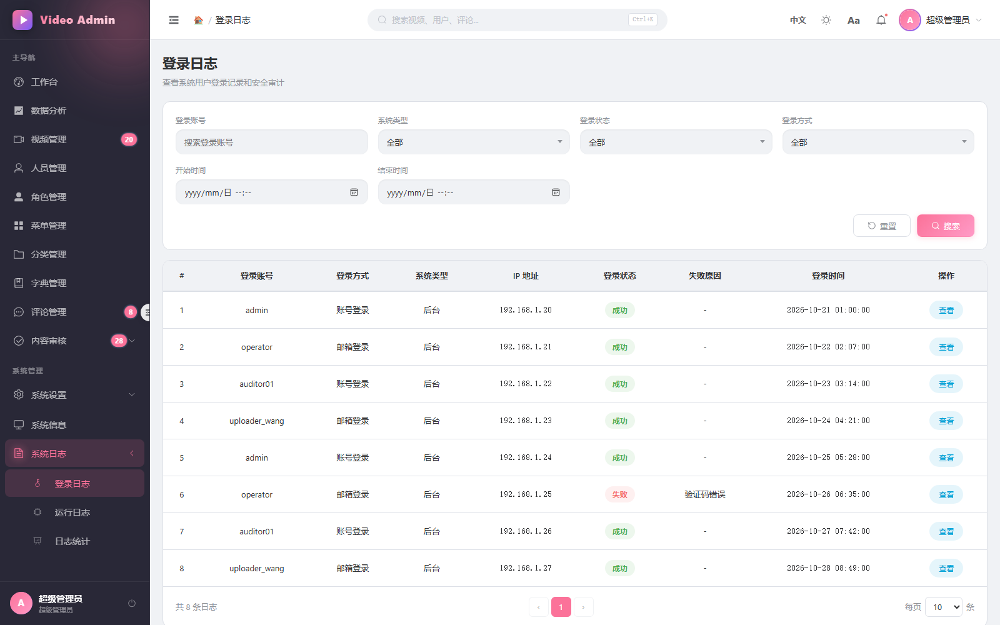

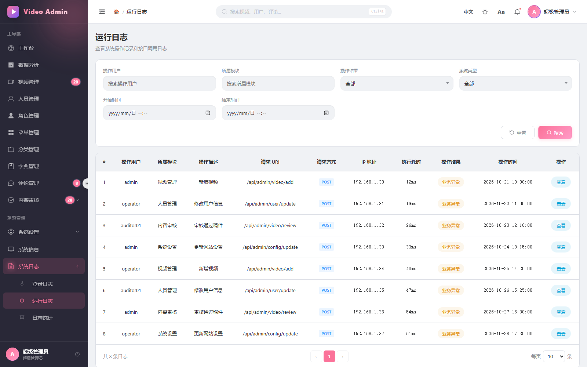

### 系统设置

网站信息、主题外观、安全策略、Token 有效期、审核开关、通知与会员定价统一配置。

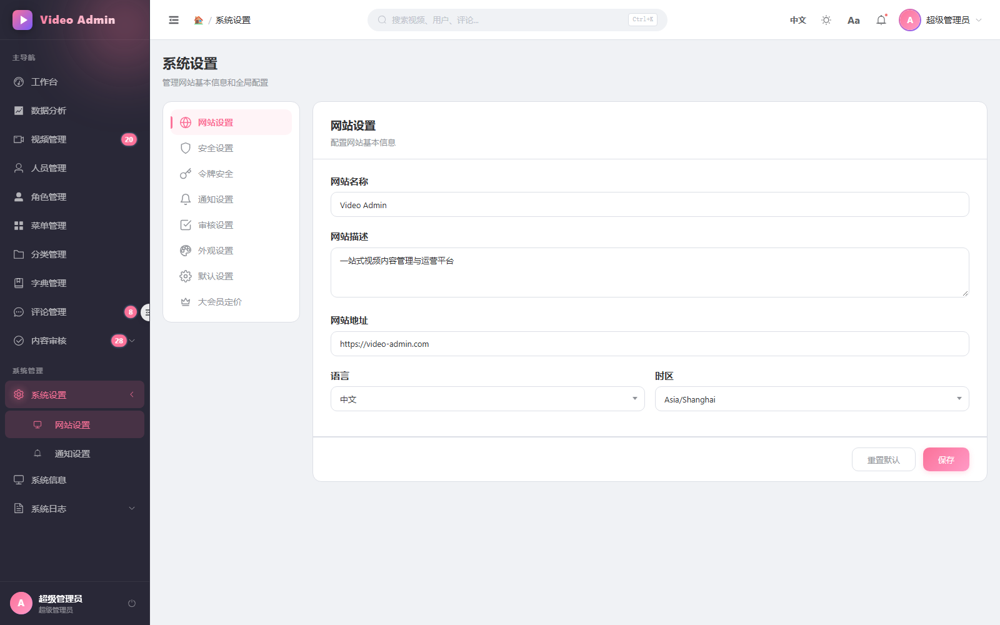

### 个人中心

个人资料、头像与密码修改。

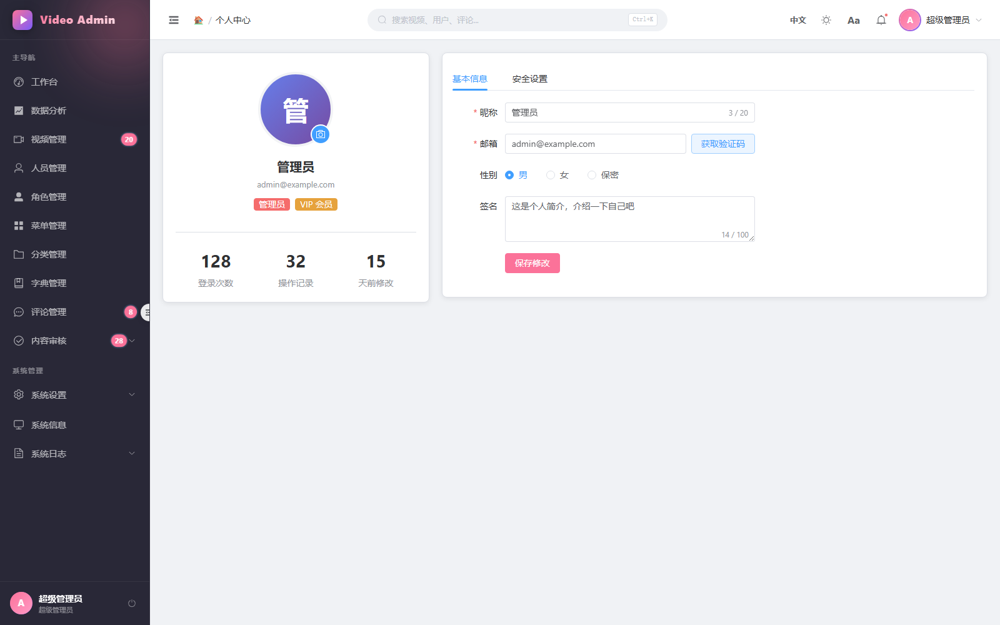

---

## 功能特性

| 分类 | 能力 |
| --- | --- |
| 内容管理 | 视频 CRUD、剧集管理、封面截帧、标签、连载状态、排序与批量操作 |
| 用户与权限 | 管理员 / 前台用户分栏管理、角色绑定、菜单权限、密码重置 |
| 内容审核 | 稿件与评论审核流、审核统计角标、投诉处理 |
| 数据可视化 | ECharts 趋势图、分布图、实时访客与分类增量分析 |
| 文件上传 | 5MB 分片、MD5 秒传、失败重试、图片 / 视频 / 音频分类上传 |
| 搜索 | 顶部全局搜索，`Ctrl + K` 聚焦，视频 / 用户 / 评论分组结果，键盘导航 |
| 主题 | 深色 / 浅色模式、主题色自定义、侧边栏风格、紧凑模式、字体与字号设置 |
| 国际化 | 中英文双语，Element Plus 组件文案同步切换 |
| 安全 | Token 自动刷新队列、401 统一登出、会话超时提醒、路由守卫 |
| 体验 | 页面过渡、骨架 / Loading、空状态、响应式布局、NProgress 进度条 |

---

## 技术栈

- **框架**：Vue 3（`<script setup>`）+ Vite 8
- **UI**：Element Plus + `@element-plus/icons-vue`
- **状态管理**：Pinia
- **路由**：Vue Router（Hash 模式）
- **请求**：Axios（统一封装、Token 刷新、错误提示）
- **图表**：ECharts 6
- **国际化**：vue-i18n 9
- **视频播放**：DPlayer、vue3-video-play、hls.js
- **工具**：dayjs、SparkMD5（分片哈希）、NProgress、@vueuse/core
- **样式**：SCSS + CSS 变量主题系统

---

## 快速开始

### 环境要求

- Node.js **20.19+**（推荐 20 LTS 或更高）
- npm 9+ / pnpm 8+
- 现代浏览器（Chrome / Edge / Firefox / Safari）

### 安装与启动

```bash
# 1. 安装依赖
npm install

# 2. 配置后端地址（见下方「环境变量」）
#    编辑根目录 .env

# 3. 启动开发服务器
npm run dev

# 4. 构建生产包
npm run build

# 5. 本地预览构建产物
npm run preview
```

默认开发端口为 **5174**，访问 <http://localhost:5174>。

---

## 环境变量

在项目根目录创建或修改 `.env`：

```dotenv
# 后端接口地址（Axios baseURL）
VITE_API_BASE_URL=http://127.0.0.1:8899/api

# 图片 / 视频等静态资源地址
VITE_OSS_BASE_URL=http://127.0.0.1:8899
```

> 开发环境下 `vite.config.js` 已将 `/api` 代理到 `http://localhost:8899`，可按需调整。

---

## 可用脚本

| 命令 | 说明 |
| --- | --- |
| `npm run dev` | 启动 Vite 开发服务器 |
| `npm run build` | 构建生产版本到 `dist/` |
| `npm run preview` | 本地预览构建产物 |
| `node scripts/capture-screenshots.mjs` | 使用无头浏览器自动生成 README 截图 |

---

## 项目结构

```text
video-administer-new/
├─ docs/
│  └─ screenshots/            # README 预览截图
├─ scripts/
│  └─ capture-screenshots.mjs # 截图生成脚本（Puppeteer + 接口 Mock）
├─ src/
│  ├─ api/                    # 接口模块（按业务拆分）
│  ├─ assets/                 # 静态资源
│  ├─ components/             # 通用组件（分页、上传等）
│  ├─ composables/            # 组合式函数（会话超时等）
│  ├─ config/                 # 全局配置（接口 / OSS 地址）
│  ├─ layouts/                # 布局、侧边栏、顶部导航
│  ├─ locales/                # 国际化语言包
│  ├─ router/                 # 路由与守卫
│  ├─ stores/                 # Pinia 状态（用户、应用、权限）
│  ├─ styles/                 # 全局样式与主题变量
│  ├─ utils/                  # 请求、鉴权、上传、格式化等工具
│  └─ views/                  # 业务页面
│     ├─ analytics/           # 数据分析
│     ├─ dashboard/           # 工作台
│     ├─ video/               # 视频 / 评论
│     ├─ user/                # 人员 / 分类
│     ├─ system/              # 角色 / 网站设置 / 通知
│     ├─ system-info/         # 系统信息
│     ├─ system-log/          # 日志
│     └─ profile/             # 个人中心
├─ .env                       # 环境变量
├─ vite.config.js
└─ package.json
```

---

## 模块说明

| 路由 | 页面 | 主要能力 |
| --- | --- | --- |
| `/login` | 登录 | 账号 / 邮箱登录、验证码 |
| `/dashboard` | 工作台 | 数据概览、趋势图、最近动态、视频列表 |
| `/data-analysis` | 数据分析 | 多维 ECharts 报表与日期筛选 |
| `/video-manage` | 视频管理 | 视频全生命周期管理、剧集与封面 |
| `/users` | 人员管理 | 管理员与用户管理、角色筛选 |
| `/roles` | 角色管理 | 角色增删改、菜单权限绑定 |
| `/menus` | 菜单管理 | 树形菜单维护 |
| `/category-manage` | 分类管理 | 分类排序、显隐与状态 |
| `/dict` | 字典管理 | 数据字典维护 |
| `/comment-manage` | 评论管理 | 评论审核、批量处理 |
| `/review` | 内容审核 | 稿件与评论审核、投诉 |
| `/settings` | 系统设置 | 网站、主题、安全、通知、会员配置 |
| `/system-info` | 系统信息 | JVM / CPU / 内存 / 磁盘监控 |
| `/system-log` | 系统日志 | 登录、运行日志与统计 |
| `/profile` | 个人中心 | 资料与密码修改 |

---

## 国际化与主题

- 语言切换会同步更新 `vue-i18n` 与 Element Plus 内置文案，语言包位于 `src/locales/messages/`。
- 主题基于 CSS 变量实现，深色模式通过 `html.dark-mode` 生效，切换时优先使用 View Transitions API 做整屏过渡。
- 支持自定义主题色、侧边栏风格（深色 / 浅色）、紧凑模式、全局字体与字号，设置持久化在 `localStorage`。

---

```

> 说明：脚本默认使用 Microsoft Edge 无头模式；若浏览器安装在非默认路径，请通过 `EDGE_PATH` 指定。调试模式可加 `SHOT_DEBUG=1` 输出请求失败与控制台错误。

---

<p align="center">Made with Vue 3 · Element Plus · ECharts</p>
